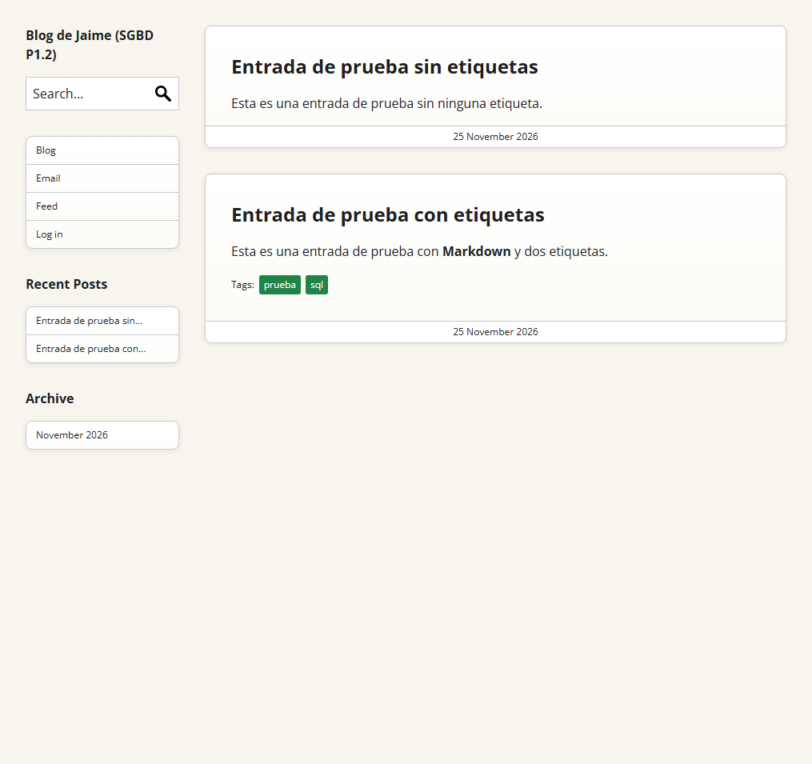
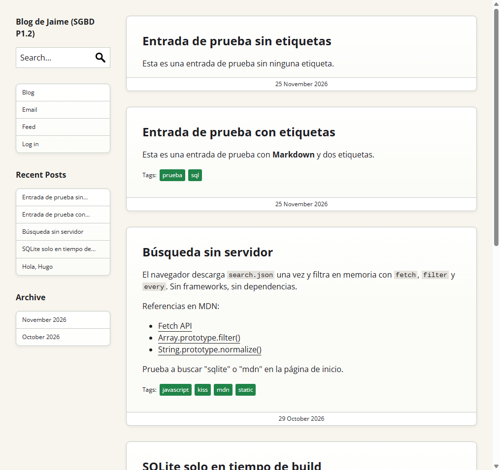

# SGBD — P1.2: de Hugo + SQLite a Chyrp Lite + SQLite

**Alumno:** Jaime Montes González (`JaimeG07`)  
**Rama Git:** `chyrp-lite`  
**Repositorio:** `JaimeG07/hugo-sqlite-proto`

---

## 1. Instalación de Chyrp Lite con SQLite — Tabla de datos

| Dato | Valor |
| --- | --- |
| Versión de PHP (`php -v`) | `PHP 8.5.9 (cli)` (extensiones activas: `PDO`, `pdo_sqlite`, `sqlite3`, `mbstring`, `curl`, `xml`) |
| Versión de Chyrp Lite | `2026.03.01` ("Sichuan") |
| Ruta del fichero `.sqlite` | `/home/jaime/chyrp-datos/blog.sqlite` (fuera de `~/chyrp/`, la carpeta servida por PHP) |
| Módulo de etiquetas | `Tagginator` (`tags`) activado desde `Extend → Modules` |
| Captura de la portada con las 2 entradas de prueba |  |

---

## 2. Exploración del esquema de Chyrp Lite

Trabajando sobre una copia (`/tmp/blog-copia.sqlite`) tras crear dos entradas de prueba (una con las etiquetas `prueba, sql` y otra sin etiquetas):

```sql
.tables
-- groups  pages  permissions  post_attributes  posts  sessions  users
```

### Respuestas basadas en `.schema` y datos reales

1. **¿Qué tablas hay y para qué sirve cada una?**
   - `posts`: almacena los metadatos comunes de cada entrada (`id`, `feather`, `clean`, `url`, `pinned`, `status`, `user_id`, `created_at`, `updated_at`).
   - `post_attributes`: almacena los campos variables de cada entrada en formato clave-valor (`title`, `body`, `tags`, etc.).
   - `pages`: almacena páginas estáticas independientes del flujo cronológico del blog (como «Acerca de»).
   - `users`: usuarios registrados (login, hash de contraseña, correo, grupo).
   - `groups` y `permissions`: roles de usuario y permisos asociados a cada grupo.
   - `sessions`: sesiones activas de los usuarios autenticados.

2. **¿Cuántas filas ocupa cada entrada en cada tabla? ¿Dónde está el título? ¿Y el cuerpo?**
   - Cada entrada ocupa **1 fila** en `posts` y **3 filas** en `post_attributes` (`name = 'title'`, `name = 'body'` y `name = 'tags'`).
   - Tanto el **título** (`name = 'title'`) como el **cuerpo** (`name = 'body'`) están en `post_attributes`, no en `posts`.

3. **¿Qué clave primaria tiene `post_attributes`? ¿Por qué es compuesta? ¿Qué clave foránea lleva?**
   - Clave primaria: `PRIMARY KEY (post_id, name)`.
   - Es **compuesta** porque una misma entrada (`post_id`) tiene varios atributos distintos (`title`, `body`, `tags`), pero cada atributo solo puede aparecer una vez por entrada.
   - Lleva la referencia lógica `post_id` → `posts.id`. Al revisar `.schema post_attributes` se comprueba que Chyrp Lite **no declara una restricción `FOREIGN KEY` en SQLite**, sino que mantiene la integridad referencial desde el código PHP.

4. **¿Existe una tabla de etiquetas? ¿Qué hay en `value` cuando `name = 'tags'`?**
   - **No** existe una tabla de etiquetas.
   - En la entrada con etiquetas (`post_id = 1`), `value` contiene un objeto JSON con pares `{nombre: slug}`:
     `{"prueba":"prueba","sql":"sql"}`
   - En la entrada sin etiquetas (`post_id = 2`), `value` guarda un array JSON vacío:
     `[]`

5. **¿Cómo se guarda la fecha? ¿Qué valor tiene `updated_at` si nunca se ha editado?**
   - Se guarda en formato texto ISO-like `YYYY-MM-DD HH:MM:SS` (ej. `2026-11-25 13:55:00`).
   - Cuando una entrada nunca se ha editado, `updated_at` vale `1000-01-01 00:00:00` (valor centinela de Chyrp Lite).

6. **¿Qué diferencia hay entre `clean` y `url` en `posts`? ¿Qué valores puede tomar `status`?**
   - `clean` es el identificador limpio (slug base) generado a partir del título; `url` es el identificador único usado en las URLs (puede diferir de `clean` si hay colisiones, añadiendo un sufijo numérico).
   - `status` puede tomar valores como `'public'`, `'draft'`, `'scheduled'`, `'registered_only'`, `'private'`, etc.

7. **Patrón EAV (`post_attributes`):**
   - **Ventaja:** un CMS modular con *feathers* (texto, foto, cita, vídeo) y módulos (etiquetas, comentarios, etc.) puede añadir atributos nuevos sin ejecutar `ALTER TABLE` ni llenar `posts` de columnas `NULL`.
   - **Inconveniente:** consultar, filtrar u ordenar por atributos (como título o etiquetas) obliga a hacer `JOIN`s repetidos contra `post_attributes` y pierde tipado estricto e índices sencillos sobre cada campo.

---

## 3. Exploración del prototipo (P1.1) y correspondencia entre esquemas

Tras regenerar `build/site.db` con `make index`:

- **Clave primaria de `posts`:** `url` (`TEXT PRIMARY KEY`).
- **Clave primaria de `tags`:** compuesta `(url, tag)` (`PRIMARY KEY (url, tag)`), con `url REFERENCES posts(url)`.
- **Relación entre entradas y etiquetas:** relación muchos a muchos (N:M) simplificada mediante una tabla puente `tags(url, tag)` sin catálogo aparte de etiquetas (la etiqueta es directamente el texto `tag`).
- **Contenido de `posts.body`:** texto plano limpio (no Markdown), porque `tools/index.py` aplica `plain()` para facilitar la búsqueda en cliente.
- **Entradas en borrador (`draft: true`):** por defecto `make index` las excluye y **no** aparecen en `build/site.db`.

### Tabla de correspondencia entre esquemas

| Prototipo (P1.1) | → | Chyrp Lite (tabla.columna o atributo) | Transformación necesaria |
| --- | --- | --- | --- |
| título (`title`) | → | `post_attributes` (`name='title'`) | Copia directa del texto (si falta, se usa el nombre del fichero sin `.md`). |
| cuerpo (Markdown de cada `.md`) | → | `post_attributes` (`name='body'`) | Se lee del `.md` original (no de `site.db`) y se hace `strip()` para conservar el formato Markdown. |
| fecha (`date`) | → | `posts.created_at` | Convertir `YYYY-MM-DD` o `YYYY-MM-DDTHH:MM` a `YYYY-MM-DD HH:MM:SS` (si falta, fecha actual). |
| nombre del fichero (`hola-hugo.md`) | → | `posts.clean` y `posts.url` | Quitar extensión `.md`, pasar a minúsculas, eliminar tildes y sustituir no alfanuméricos por `-` (`slugify`). |
| `description` / `summary` | → | *(sin equivalente)* | Se pierde: Chyrp Lite no tiene campo de resumen en el *feather* `text`. |
| etiquetas (`tags`) | → | `post_attributes` (`name='tags'`) | De lista YAML a JSON `{"Nombre":"slug"}` (o `[]` si está vacía); `/` escapado como `\/`. |
| `draft: true` | → | `posts.status` | `True` → `'draft'`, `False` → `'public'`. |
| autor | → | `posts.user_id` | No existe en el prototipo por defecto: se asigna el `id` del primer usuario de `users` o el indicado con `--autor` (y en el Ej. 4, el campo opcional `author` del front matter). |
| columnas sin origen (`feather`, `pinned`, `updated_at`) | → | `posts.feather`, `posts.pinned`, `posts.updated_at` | Valores fijos: `feather='text'`, `pinned=0`, `updated_at='1000-01-01 00:00:00'`. |

---

## 4.4 Lectura guiada de `tools/migrar.py`

1. **¿Qué funciones tocan el disco o SQL y cuáles no? ¿Por qué `test_migrar.py` puede probar `transformar` sin base de datos?**
   - **Puras (sin disco ni SQL):** `slugify`, `fecha_chyrp`, `etiquetas_json`, `transformar` (y `transformar_pagina` en el Ej. 2).
   - **Con efectos (disco/SQL):** `leer_entrada` y `extraer` (leen disco); `comprobar_destino`, `buscar_autor`, `existe`, `insertar`, `cargar` (leen/escriben SQLite).
   - Como `transformar` solo recibe diccionarios y valores simples (incluso `ahora` y `user_id` se pasan como parámetros) y devuelve un diccionario nuevo sin mutar la entrada ni acceder al exterior, `unittest` puede probarla en memoria en milisegundos sin crear ficheros ni bases de datos.

2. **¿Dónde empieza y termina la transacción? ¿Qué pasaría si falla el `INSERT` de la 3.ª entrada?**
   - La transacción está delimitada por el bloque `with con:` dentro de `cargar()`.
   - Si ocurre una excepción al insertar la 3.ª entrada, el gestor de contexto `with con:` ejecuta automáticamente un **`ROLLBACK`**, deshaciendo también las inserciones de la 1.ª y 2.ª entrada: la base de datos queda exactamente como estaba antes de empezar (propiedad de **atomicidad**).

3. **¿Qué columna usa el script para saber si una entrada ya está migrada? ¿Es buena elección?**
   - Usa `posts.url` (`SELECT 1 FROM posts WHERE url = ?`).
   - Funciona bien mientras los ficheros tengan nombres únicos en `content/posts/`, porque `url` identifica cada entrada de forma única en Chyrp Lite. Sin embargo, si existieran dos ficheros con el mismo nombre en subcarpetas distintas (p. ej. `2025/notas.md` y `2026/notas.md`), ambos producirían `path.stem == "notas"` y el segundo se omitiría al considerarlo duplicado.

4. **¿Por qué `etiquetas_json` devuelve `[]` y no `{}` cuando no hay etiquetas?**
   - Porque en PHP un array vacío (`array()`) se serializa con `json_encode([])` como `[]` (lista JSON), no como `{}`. Tal como comprobamos en la entrada de prueba sin etiquetas (`post_id = 2`), Chyrp Lite guarda literalmente `[]` en `post_attributes`.

5. **¿Por qué `updated_at` vale `1000-01-01 00:00:00`? ¿De dónde sale?**
   - Es la constante `SQL_DATETIME_ZERO` que Chyrp Lite usa internamente para representar una entrada que todavía no ha sido editada (evitando problemas de `NULL` o `0000-00-00 00:00:00` en modo estricto de SQL). Lo observamos directamente en `SELECT * FROM posts` en la Parte 2.

6. **¿Por qué se usa `cur.lastrowid` entre los dos `INSERT`?**
   - Porque `posts.id` es `AUTOINCREMENT` y lo genera SQLite al insertar la fila en `posts`. `cur.lastrowid` recupera ese `id` recién asignado para usarlo como `post_id` al insertar las filas de `title`, `body` y `tags` en `post_attributes`.

7. **Comparación entre `transformar` y la tabla de correspondencia de la Parte 3:**
   - Coincide prácticamente en todos los campos (`feather='text'`, `pinned=0`, `updated_at='1000-01-01 00:00:00'`, `status` según `draft`, pérdida de `description`). El detalle más fino que añade el script es escapar `/` como `\/` en `etiquetas_json` para igualar exactamente los bytes que produce PHP.

---

## 5. Ejecución de la migración (evidencias)

1. **Pruebas unitarias iniciales (`make test`):**
   ```text
   Ran 11 tests in 0.001s — OK
   ```
2. **Simulacro (`make migrar DESTINO=$HOME/chyrp-datos/copia.sqlite SIMULACRO=1`):**
   ```text
   simulada  borrador
   simulada  busqueda-sin-servidor
   simulada  hola-hugo
   simulada  sqlite-en-build-time
   migrar: 4 entradas leídas, 4 nuevas, 0 ya estaban
   ```
3. **Migración real (`make migrar DESTINO=$HOME/chyrp-datos/copia.sqlite`):**
   ```text
   creada    borrador
   creada    busqueda-sin-servidor
   creada    hola-hugo
   creada    sqlite-en-build-time
   migrar: 4 entradas leídas, 4 nuevas, 0 ya estaban
   ```
4. **Repetición (idempotencia):**
   ```text
   omitida   borrador
   omitida   busqueda-sin-servidor
   omitida   hola-hugo
   omitida   sqlite-en-build-time
   migrar: 4 entradas leídas, 0 nuevas, 4 ya estaban
   ```

---

## 6. Verificación de la migración (SQL y navegador)

### Consultas SQL sobre `~/chyrp-datos/blog.sqlite`

```sql
SELECT COUNT(*) AS total_posts FROM posts;
-- total_posts = 6 (2 de prueba + 4 migradas, incluido el borrador)

SELECT p.id, p.clean, p.status, p.created_at, a.value AS titulo
FROM posts p
JOIN post_attributes a ON a.post_id = p.id AND a.name = 'title'
ORDER BY p.id;
```

| id | clean | status | created_at | titulo |
| --- | --- | --- | --- | --- |
| 1 | `entrada-de-prueba-con-etiquetas` | `public` | `2026-11-25 13:55:00` | Entrada de prueba con etiquetas |
| 2 | `entrada-de-prueba-sin-etiquetas` | `public` | `2026-11-25 13:55:00` | Entrada de prueba sin etiquetas |
| 3 | `borrador` | `draft` | `2026-10-29 00:00:00` | Esto es un borrador |
| 4 | `busqueda-sin-servidor` | `public` | `2026-10-29 00:00:00` | Búsqueda sin servidor |
| 5 | `hola-hugo` | `public` | `2026-10-27 00:00:00` | Hola, Hugo |
| 6 | `sqlite-en-build-time` | `public` | `2026-10-28 00:00:00` | SQLite solo en tiempo de build |

```sql
SELECT COUNT(*) AS posts_con_static
FROM post_attributes
WHERE name = 'tags' AND value LIKE '%:"static"%';
-- posts_con_static = 3 (coincide con data/tags.json: {"tag":"static","total":3})
```

### Comprobación en el navegador (como visitante)

| Comprobación | Resultado observado |
| --- | --- |
| Entradas visibles en portada (`http://192.168.1.160:8080/`) | **5 entradas** (2 de prueba + 3 públicas migradas; el borrador no aparece). |
| Entrada con 3 etiquetas (`Hola, Hugo`) | Muestra las 3 etiquetas: `hugo`, `kiss`, `static`. |
| Página de etiqueta (`/?action=tag&name=static`) | Lista exactamente **3 entradas** (`Búsqueda sin servidor`, `SQLite solo en tiempo de build`, `Hola, Hugo`), igual que `data/tags.json`. |
| Fecha de entrada antigua (`Hola, Hugo`) | Conserva su fecha original: `27 October 2026`. |
| Formato del cuerpo Markdown | Bloques de código, negritas, cursivas y enlaces renderizados correctamente. |
| Entrada en borrador (`/?action=view&url=borrador`) | Devuelve **HTTP 404 Not Found** al visitante (pero existe con `status='draft'` en el panel/BD). |
| Segunda ejecución de `make migrar` | Todas marcadas como `omitida`; el total de entradas no cambia. |



---

## Ejercicios resueltos

### Ejercicio 1 — Romper la transacción a propósito (experimento)
- **Qué se probó:** Sobre dos copias limpias de `blog-original.sqlite` (con las 2 entradas de prueba iniciales), se provocó `raise RuntimeError("fallo simulado en la 3a entrada")` al insertar la 3.ª entrada nueva, primero **con `with con:`** y después **sin transacción** (`isolation_level=None`, autocommit por sentencia).
- **Resultado esperado y observado:**
  - **Con `with con:`:** antes = `2` posts; tras el error = **`2` posts y `6` atributos** (rollback completo, cero datos a medias).
  - **Sin `with con:`:** antes = `2` posts; tras el error = **`5` posts y `15` atributos** (quedaron guardadas las entradas anteriores al fallo, dejando la migración a medias).
- **Aprendizaje:** En un proceso ETL que escribe en varias tablas (`posts` + `post_attributes`), envolver todo el lote en una transacción garantiza «todo o nada» ante cualquier fallo.

### Ejercicio 2 — Migrar las páginas a la tabla `pages` (commit `67840ac`)
- **Qué se cambió:** Tras inspeccionar `.schema pages` (`title, body, public, show_in_list, list_order, clean, url, user_id, parent_id, created_at, updated_at`), se añadieron a `tools/migrar.py` la función pura `transformar_pagina()`, `extraer_paginas()`, `existe_pagina()`, `insertar_pagina()`, `cargar_paginas()` y el parámetro opcional `--paginas` (también soportado en `Makefile` mediante `PAGINAS=content`). Se añadieron pruebas en `TestTransformarPagina` en `tools/test_migrar.py`.
- **Cómo se comprobó:** `make test` (13 tests en verde) y `make migrar DESTINO=/home/jaime/chyrp-datos/copia.sqlite PAGINAS=content` ejecutado dos veces: la 1.ª creó `about` y `tutorial-sql` en la tabla `pages`; la 2.ª las marcó como `omitida`.

### Ejercicio 5 — Descubrir un límite: etiqueta numérica `2026` (commit `6de734d`)
- **Qué se descubrió:** Al publicar desde `Write` una entrada con la etiqueta `2026`, Chyrp Lite **no** guarda `{"2026":"2026"}`, sino:
  `{"\ufe0e2026":"a3a10ebe2ba87b81b32702fce0637e74"}`
  Al revisar `modules/tags/tags.php`, vimos el motivo: PHP convierte claves de string numéricas en enteros (*type-juggling*), así que Tagginator antepone el carácter Unicode `U+FE0E` (`\ufe0e`) a cualquier etiqueta `is_numeric()` y sustituye por `md5(nombre)` cualquier slug que solo contenga dígitos o guiones.
- **Qué se cambió:** Se actualizó `etiquetas_json()` en `tools/migrar.py` (con la función auxiliar pura `_es_numerica()`) para reproducir exactamente ese comportamiento, y se añadió `test_etiqueta_numerica` en `tools/test_migrar.py`.
- **Cómo se comprobó:** `make test` (14 tests en verde), verificando la coincidencia byte a byte con el valor real guardado por Chyrp Lite.

### Ejercicio 4 — Aportar un autor: `--autor` y campo `author` en front matter (commit `b4f17b9`)
- **Qué se cambió:** Se actualizó `leer_entrada()` para leer el campo opcional `author` del front matter y `transformar()` para aceptar un diccionario `autores={login: id}` (manteniendo la función pura) de modo que si el `.md` especifica un `author` válido usa su `user_id` y, si no, usa el de `--autor` (o el primer usuario). Se añadieron dos pruebas (`test_autor_en_front_matter` y `test_autor_desconocido_usa_por_defecto`) en `tools/test_migrar.py`.
- **Cómo se comprobó:** `make test` (16 tests en verde) y prueba real sobre `/tmp/autor-copia.sqlite` con un segundo usuario `editor` (`id = 2`): al migrar con `--autor editor`, las 4 entradas migradas quedaron con `user_id = 2`, mientras las 2 de prueba siguieron con `user_id = 1`.

---

## Mini-reto: entrada nueva desde Write e inspección en la BD

Se publicó desde `Write` la entrada **«Mini-reto desde Write»** con las etiquetas `sql, chyrp` (una existente y otra nueva).

- **Filas aparecidas:**
  - En `posts`: **1 fila nueva** (`id = 8`, `clean = 'mini-reto-desde-write'`, `status = 'public'`, `updated_at = '1000-01-01 00:00:00'`).
  - En `post_attributes`: **3 filas nuevas** (`(8, 'title', 'Mini-reto desde Write')`, `(8, 'body', '...')`, `(8, 'tags', '{"sql":"sql","chyrp":"chyrp"}')`).
  - **¿Por qué más de una fila?** Porque Chyrp Lite separa la cabecera común en `posts` y los atributos del *feather*/módulos en filas individuales de `post_attributes` (modelo EAV). Al añadir la etiqueta nueva `chyrp` **no** aparece ninguna fila en una tabla de etiquetas: simplemente se serializa dentro del JSON de la fila `tags` de esa entrada.
- **Consulta por etiqueta `sql` en Chyrp Lite (`LIKE`) vs. Prototipo (`JOIN`):**
  ```sql
  -- Chyrp Lite (busca subcadena dentro del JSON serializado):
  SELECT p.id, p.clean, a.value
  FROM posts p
  JOIN post_attributes a ON a.post_id = p.id
  WHERE a.name = 'tags' AND a.value LIKE '%:"sql"%';
  -- Devuelve id=1 (entrada-de-prueba-con-etiquetas) e id=8 (mini-reto-desde-write).

  -- Prototipo P1.1 (relacional normalizado):
  SELECT p.url, p.title
  FROM posts p
  JOIN tags t ON t.url = p.url
  WHERE t.tag = 'sql';
  ```
  La consulta de Chyrp Lite obliga a escanear texto con `LIKE` (no puede aprovechar un índice B-Tree estándar sobre el prefijo `%`), mientras que la del prototipo busca por igualdad exacta sobre una clave indexada.

---

## Preguntas para reflexionar

1. **Si SQLite fallaba en producción en la P1.1 vs. ahora en Chyrp Lite:**
   En la P1.1 SQLite ni siquiera existía en producción: el servidor solo servía HTML/JSON estáticos, así que un fallo de SQLite solo afectaba al momento de compilar el sitio, nunca a los visitantes. En Chyrp Lite, PHP consulta SQLite en cada petición: si el fichero `.sqlite` se corrompe, se bloquea o falta, el blog entero deja de funcionar (menor disponibilidad y mayor superficie de fallo).

2. **Concurrencia con 50 usuarios a la vez y paso a MySQL/PostgreSQL:**
   Para 50 usuarios solo leyendo, SQLite suele aguantar bien, pero si varios usuarios escriben a la vez (comentarios, sesiones, edición simultánea) aparecen bloqueos (`database is locked`) porque SQLite bloquea la base de datos completa en escritura. Tiene sentido pasar a MySQL o PostgreSQL cuando hay alta concurrencia de escritura, varios servidores web accediendo a la misma base de datos o necesidad de replicación y copias en caliente.

3. **Copia de seguridad en Chyrp Lite vs. P1.1:**
   En Chyrp Lite la base de datos es la **fuente de la verdad**: hay que respaldar `/home/jaime/chyrp-datos/blog.sqlite` (preferiblemente con `.backup` de `sqlite3` para evitar copias inconsistentes en caliente) además de los ficheros de configuración (`includes/config.json.php`) y subidas (`uploads/`). En la P1.1 bastaba con respaldar el repositorio Git con los Markdown; `build/site.db` se podía borrar y regenerar en cualquier momento.

4. **Normalización (1FN):**
   `tags(url, tag)` cumple la 1FN porque cada celda contiene un único valor atómico. Chyrp Lite incumple la 1FN al guardar varias etiquetas serializadas en una sola columna `value`. Esto dificulta consultas como contar entradas por etiqueta (`GROUP BY`), renombrar una etiqueta globalmente o garantizar unicidad sin parsear JSON. A cambio, Chyrp Lite gana simplicidad de esquema: el módulo de etiquetas se activa y desactiva sin crear ni alterar tablas propias.

5. **Riesgos de escribir directamente en tablas de otra aplicación:**
   Se saltan validaciones, generación automática de slugs únicos, limpieza de caché, ganchos (*triggers*/hooks) de otros módulos y peculiaridades de formato (como el `U+FE0E` + `md5` de etiquetas numéricas que descubrimos en el Ejercicio 5). Si Chyrp Lite ofreciera una API REST o un importador oficial, sería más seguro usarlo porque delegaría en la propia aplicación todas las reglas de negocio.

6. **Por qué el módulo `Migration` de Chyrp Lite no servía aquí:**
   Solo incluye importadores para WordPress, Tumblr, TextPattern y MovableType, cuyos formatos de exportación (XML/JSON propios) no tienen nada que ver con ficheros Markdown + front matter YAML de Hugo. Para importar un sitio Hugo tendría que incluir un parser de front matter YAML/TOML + Markdown capaz de mapear `content/posts/` y `content/*.md` a `posts`, `post_attributes` y `pages`.