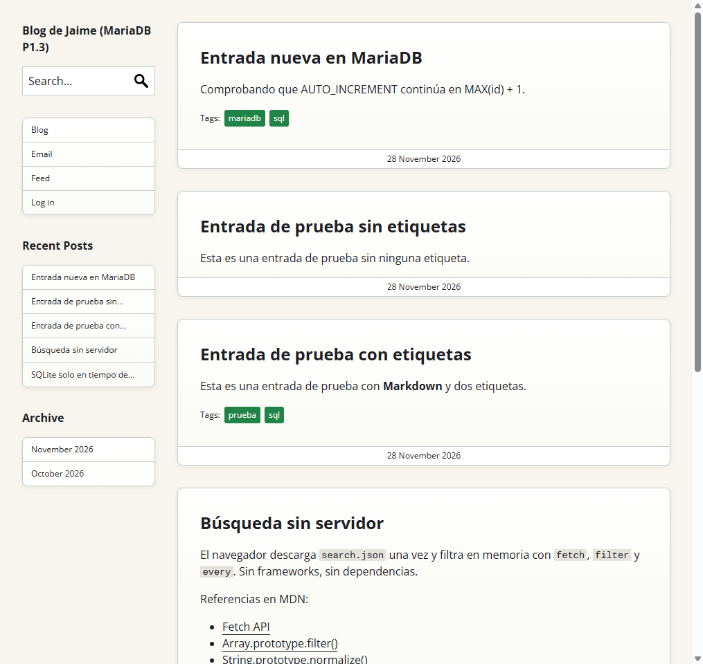

# SGBD — P1.3: de Chyrp Lite + SQLite a MariaDB

**Alumno:** Jaime Montes González (`JaimeG07`)  
**Rama Git:** `mariadb`  
**Repositorio:** `JaimeG07/hugo-sqlite-proto`

---

## 1. Instalación de MariaDB y preparación de la base de datos — Tabla de datos

| Dato | Valor |
| --- | --- |
| Servicio MariaDB (`systemctl status mariadb`) | `active (running)` (`mariadb.service - MariaDB 11.8.6 database server`) |
| Versión de MariaDB (`SELECT VERSION();`) | `11.8.6-MariaDB-5ubuntu0.1 from Ubuntu` |
| Versión de PHP y driver (`php -m \| grep pdo_mysql`) | `PHP 8.5.4 (cli)` con `PDO`, `pdo_mysql`, `mysqli`, `pdo_sqlite`, `sqlite3` |
| Juego de caracteres (`SHOW CREATE DATABASE chyrp;`) | `CREATE DATABASE `chyrp` /*!40100 DEFAULT CHARACTER SET utf8mb4 COLLATE utf8mb4_unicode_ci */` |
| Usuario y `host` creados | `'chyrp'@'localhost'` (privilegios mínimos: solo sobre `chyrp.*`) |
| Comprobación de conexión (`mariadb -u chyrp -p chyrp`) | `DATABASE() = chyrp`, `CURRENT_USER() = chyrp@localhost` |

### Resultado de `SHOW GRANTS FOR 'chyrp'@'localhost';`

```sql
MariaDB> SHOW GRANTS FOR 'chyrp'@'localhost';
GRANT USAGE ON *.* TO `chyrp`@`localhost` IDENTIFIED BY PASSWORD '*EF44A437E6F7167F93FA0064336E8AF84D7B0162'
GRANT ALL PRIVILEGES ON `chyrp`.* TO `chyrp`@`localhost`
```

---

## 2. Instalación de Chyrp Lite sobre MariaDB y exploración de esquemas

Chyrp Lite `2026.03.01` ("Sichuan") se instaló en una carpeta independiente (`~/chyrp-maria`, servido en `http://192.168.1.161:8081`) usando el adaptador `MySQL` (`host=localhost`, `port=3306`, `database=chyrp`, usuario `chyrp`), manteniendo el blog SQLite de la P1.2 en paralelo en `http://192.168.1.161:8080`.

### Esquema real observado en MariaDB

```sql
CREATE TABLE `posts` (
  `id` int(11) NOT NULL AUTO_INCREMENT,
  `feather` varchar(32) DEFAULT '',
  `clean` varchar(128) DEFAULT '',
  `url` varchar(128) DEFAULT '',
  `pinned` tinyint(1) DEFAULT 0,
  `status` varchar(32) DEFAULT 'public',
  `user_id` int(11) DEFAULT 0,
  `created_at` datetime DEFAULT NULL,
  `updated_at` datetime DEFAULT NULL,
  PRIMARY KEY (`id`)
) ENGINE=InnoDB DEFAULT CHARSET=utf8mb4 COLLATE=utf8mb4_general_ci;
```

```sql
DESCRIBE post_attributes;
-- post_id | int(11)      | NO | PRI | NULL
-- name    | varchar(100) | NO | PRI | ''
-- value   | longtext     | YES|     | NULL

SELECT @@sql_mode;
-- STRICT_TRANS_TABLES,ERROR_FOR_DIVISION_BY_ZERO,NO_AUTO_CREATE_USER,NO_ENGINE_SUBSTITUTION
```

### Respuestas a las preguntas de la Parte 2

1. **¿Hay las mismas tablas en los dos motores? ¿Cuál existe solo en SQLite y para qué sirve?**
   - Las 7 tablas de Chyrp Lite son idénticas (`groups`, `pages`, `permissions`, `post_attributes`, `posts`, `sessions`, `users`).
   - En SQLite aparece una tabla interna adicional en `sqlite_master`: **`sqlite_sequence`**, que SQLite crea automáticamente al usar `AUTOINCREMENT` para recordar el mayor `id` asignado en cada tabla (aunque se borren filas).

2. **¿Cómo se declara la clave primaria autoincremental en cada motor? ¿Qué es `ENGINE=InnoDB` y por qué importa para las transacciones?**
   - En SQLite: `id INTEGER PRIMARY KEY AUTOINCREMENT`.
   - En MariaDB: `` `id` int(11) NOT NULL AUTO_INCREMENT, PRIMARY KEY (`id`) ``.
   - **`InnoDB`** es el motor de almacenamiento transaccional por defecto de MariaDB. Importa porque soporta **transacciones ACID (`START TRANSACTION` / `COMMIT` / `ROLLBACK`)**, bloqueos a nivel de fila y recuperación ante caídas (a diferencia de motores antiguos como `MyISAM`, que ignoran las transacciones y bloquean la tabla entera).

3. **¿En qué se convierte `BOOLEAN` de SQLite en MariaDB? ¿Y `DATETIME` y `LONGTEXT`?**
   - `BOOLEAN` de SQLite pasa a **`tinyint(1)`** en MariaDB (`0` o `1`).
   - `DATETIME` en SQLite se guarda internamente como texto (afinidad numérica/texto sin validación estricta), mientras que en MariaDB es un tipo **`datetime`** nativo validado.
   - `LONGTEXT` en SQLite es simplemente afinidad `TEXT`; en MariaDB es **`longtext`** (hasta ~4 GB de texto).

4. **`VARCHAR(128)` existe en ambos esquemas, pero solo uno lo hace cumplir. ¿Cuál? ¿Qué hace `sql_mode`?**
   - Solo **MariaDB** impone la longitud máxima de `VARCHAR(128)` (SQLite ignora las longitudes entre paréntesis).
   - Como `@@sql_mode` incluye **`STRICT_TRANS_TABLES`**, intentar insertar un texto de más de 128 caracteres en MariaDB **rechaza la sentencia con `ERROR 1406 (22001): Data too long for column`** en lugar de truncarlo silenciosamente.

5. **¿Qué significan `DEFAULT CHARSET=utf8mb4` y `COLLATE utf8mb4_general_ci`? ¿Relación con mayúsculas?**
   - `DEFAULT CHARSET=utf8mb4` indica codificación UTF-8 completa de hasta 4 bytes por carácter (soporta tildes, ñ y emojis como `🔀`).
   - `COLLATE utf8mb4_general_ci` define las reglas de comparación y ordenación; el sufijo **`_ci` (*case-insensitive*)** significa que MariaDB **no distingue mayúsculas de minúsculas** al comparar cadenas (por ejemplo, `'Admin' = 'admin'`).

6. **¿Qué filas ha creado ya el instalador en `users`, `groups` y `permissions`?**
   - `users`: **1 fila** (`id = 1`, `login = 'admin_temp'`, el administrador temporal).
   - `groups`: **5 filas** (`Admin`, `Member`, `Friend`, `Banned`, `Guest`).
   - `permissions`: **73 filas** (los permisos base de Chyrp Lite).
   - La migración tendrá que vaciar y sustituir estas filas por las del blog SQLite de la P1.2 para que existan los mismos usuarios, grupos y permisos.

---

## 3. Correspondencia entre motores (SQLite → MariaDB)

| Concepto | En SQLite (P1.2) | → | En MariaDB (P1.3) | ¿Qué puede salir mal al migrar? |
| --- | --- | --- | --- | --- |
| Clave autoincremental | `INTEGER PRIMARY KEY AUTOINCREMENT` (estado en `sqlite_sequence`) | → | `int(11) NOT NULL AUTO_INCREMENT` | Al insertar filas con `id` explícito (`1..6`), MariaDB actualiza automáticamente el contador interno a `MAX(id) + 1` (`7`), evitando colisiones en altas futuras. |
| Booleanos | `BOOLEAN` (`0`/`1`, afinidad numérica) | → | `tinyint(1)` (`0`/`1`) | Si se pasaran cadenas como `'true'`/`'false'` fallaría en modo estricto; hay que emitir `1`/`0`. |
| Fechas y horas | `DATETIME` guardado como `TEXT` (`YYYY-MM-DD HH:MM:SS`) | → | Tipo nativo `datetime` | Fechas mal formateadas o vacías `''` provocan error en `STRICT_TRANS_TABLES`; el formato `1000-01-01 00:00:00` sí es válido en MariaDB. |
| Texto largo (cuerpo) | `LONGTEXT` (afinidad `TEXT`) | → | `longtext` | Saltos de línea, comillas o caracteres especiales deben escaparse correctamente en el volcado SQL. |
| Longitud de `VARCHAR` | No se valida (SQLite acepta cualquier longitud) | → | Validada en modo estricto (`STRICT_TRANS_TABLES`) | Un valor más largo de `VARCHAR(128)` que SQLite aceptó lanzará `ERROR 1406: Data too long for column`. |
| Comparación de texto (`'Admin'` vs `'admin'`) | Sensible a mayúsculas por defecto (`BINARY`) | → | Insensible (`utf8mb4_general_ci`) | Dos valores que SQLite permitía como distintos en una columna `UNIQUE` (p. ej. `Admin` y `admin`) producen `ERROR 1062: Duplicate entry` en MariaDB. |
| Comillas en nombres de tablas (`groups`) | Comillas dobles (`"groups"`) | → | Comillas invertidas / *backticks* (`` `groups` ``) | `GROUPS` es palabra reservada en MariaDB/MySQL; sin backticks produce error de sintaxis. |
| Comillas dentro de texto (`O'Brien`) | Comilla simple duplicada (`'O''Brien'`) | → | Comilla simple duplicada (`'O''Brien'`) y barra invertida escapada (`\\`) | Sin escapar rompe la sentencia SQL (error de sintaxis o riesgo de inyección SQL); además MariaDB interpreta `\` como carácter de escape. |
| Juego de caracteres | UTF-8 por defecto | → | `utf8mb4` (hay que fijar `SET NAMES utf8mb4`) | Si la conexión usa `latin1` o `utf8mb3`, los acentos salen corruptos (`á`) y los emojis (`🔀`) fallan o se truncan. |
| Tabla `sessions` | Sesiones activas de SQLite | → | Sesiones de MariaDB | **No hay que moverla:** son sesiones temporales caducables de otra instancia; al iniciar sesión en `:8081` se genera una nueva. |

---

## 4.4 Lectura guiada de `tools/sqlite2maria.py`

1. **¿Qué funciones tocan el disco y cuáles no? ¿Por qué el script no se conecta a MariaDB y delega en `mariadb`?**
   - **Puras (no tocan disco ni red):** `literal`, `ident`, `insert_lote`, `lotes`, `sentencias_tabla`, `volcado`.
   - **Con efectos:** `listar_tablas` y `leer_tabla` (leen el `.sqlite`), y `main` (parsea argumentos, escribe el SQL en `stdout` y el resumen en `stderr`).
   - Delega en el cliente `mariadb` por filosofía Unix (un filtro que produce texto SQL estándar) y porque la biblioteca estándar de Python no incluye un driver de MariaDB/MySQL; así el script no requiere dependencias externas (`pip`) y el `.sql` generado puede inspeccionarse antes de cargarlo.

2. **¿Por qué se hace `DELETE` antes de los `INSERT`? ¿Qué error daría MariaDB en una segunda carga sin ese `DELETE`?**
   - Porque el instalador de Chyrp Lite ya pobló `users`, `groups` y `permissions`, y además permite repetir la carga las veces que haga falta sin duplicar datos (repetibilidad).
   - Sin el `DELETE`, una segunda carga fallaría inmediatamente con **`ERROR 1062 (23000): Duplicate entry '1' for key 'PRIMARY'`**.

3. **¿Dónde empieza y termina la transacción? ¿Qué pasa si falla la 3.ª tabla? ¿Por qué `DELETE` y no `TRUNCATE`?**
   - Empieza en `PREAMBULO` (`START TRANSACTION;`) y termina en `EPILOGO` (`COMMIT;`).
   - Si falla un `INSERT` de la 3.ª tabla, el cliente `mariadb` aborta la ejecución antes del `COMMIT` y MariaDB hace **`ROLLBACK` automático**, deshaciendo los `DELETE` e `INSERT` de las tablas 1 y 2.
   - Se usa `DELETE` y no `TRUNCATE` porque en MariaDB/MySQL **`TRUNCATE TABLE` es una sentencia DDL que provoca un `COMMIT` implícito**: rompería la transacción y no se podría deshacer si algo fallara después.

4. **En `literal()`, ¿por qué se duplican `'` y se escapa `\`? ¿Qué pasaría con `O'Brien`? ¿Riesgo de seguridad?**
   - En SQL las cadenas van entre comillas simples (`'...'`), así que `'` dentro del texto debe duplicarse (`''`), y MariaDB además interpreta `\` como escape (por lo que `\` debe pasar a `\\`). Sin escapar, `'O'Brien'` cerraría la cadena tras la `O` y `Brien'` daría error de sintaxis.
   - Construir SQL concatenando texto con datos ajenos abre la puerta a **inyección SQL (SQLi)**. En una aplicación web nunca se escapa a mano: se usan **consultas preparadas (parametrizadas)** con marcadores `?` o `:param` (PDO / `sqlite3`), donde el motor separa código SQL y datos.

5. **¿Para qué sirve `SET NAMES utf8mb4`? ¿Qué pasaría con `árbol 🔀` sin él?**
   - Indica al servidor MariaDB que el flujo SQL que envía el cliente viene codificado en `utf8mb4`. Sin él, si el cliente negociara `latin1` o `utf8mb3`, `árbol` se corrompería (*mojibake*, p. ej. `árbol`) y el emoji de 4 bytes `🔀` fallaría con `Incorrect string value` o se perdería.

6. **Chyrp Lite no declara claves foráneas. ¿Por qué pone igualmente `SET FOREIGN_KEY_CHECKS=0`?**
   - Porque el script vuelca las tablas por **orden alfabético** (`groups`, `pages`, `permissions`, `post_attributes`, `posts`, `users`), no en orden topológico de dependencias (por ejemplo, `post_attributes` se inserta antes que `posts`, y `posts` antes que `users`). Desactivar temporalmente la comprobación hace que el script sea reutilizable aunque el esquema destino sí tuviera claves foráneas.

7. **¿Por qué se abre SQLite en solo lectura (`mode=ro`) y por qué se omite `sessions`?**
   - `mode=ro` garantiza que el script **nunca** modificará el fichero de origen ni creará uno vacío si la ruta está mal escrita (falla limpiamente si no existe).
   - Se omite `sessions` porque contiene sesiones efímeras de PHP ligadas a cookies de la instancia anterior; no son datos del blog y caducan igualmente.

8. **Comparación con la tabla de la Parte 3:**
   - Coincide completamente: usa backticks en `ident()`, escapa `'` y `\` (más `\0` y `\x1a`), convierte `bool` a `1`/`0`, emite `SET NAMES utf8mb4`, excluye `sessions` y deja la creación de tablas al instalador de Chyrp Lite.

---

## 5. Carga de datos en MariaDB (evidencias)

1. **Pruebas unitarias (`make test`):**
   ```text
   Ran 29 tests in 0.002s — OK
   ```
2. **Generación del volcado (`make maria ORIGEN=$HOME/chyrp-datos/origen-p13.sqlite`):**
   ```text
   sqlite2maria: groups               5 filas
   sqlite2maria: pages                0 filas
   sqlite2maria: permissions         73 filas
   sqlite2maria: post_attributes     18 filas
   sqlite2maria: posts                6 filas
   sqlite2maria: users                1 filas
   ```
3. **Inspección de `build/chyrp.sql` (`head -25 build/chyrp.sql`):**
   ```sql
   SET NAMES utf8mb4;
   SET FOREIGN_KEY_CHECKS=0;
   START TRANSACTION;
   -- groups: 5 filas
   DELETE FROM `groups`;
   INSERT INTO `groups` (`id`, `name`) VALUES
   (1, 'Admin'),
   (2, 'Member'),
   (3, 'Friend'),
   (4, 'Banned'),
   (5, 'Guest');
   ```
4. **Carga y repetibilidad:**
   - 1.ª carga (`mariadb -u chyrp -p chyrp < build/chyrp.sql`): ejecutada sin errores.
   - 2.ª carga (`mariadb -u chyrp -p chyrp < build/chyrp.sql`): ejecutada sin errores y dejando exactamente los mismos recuentos.
5. **Acceso con el usuario de la P1.2 (`jaime` / `jaime`) y activación de Tagginator:**
   - Al cargar `users`, el usuario temporal `admin_temp` fue sustituido por `jaime`. La contraseña de la P1.2 funciona directamente en MariaDB porque `users.password` guarda un hash **SHA-512 crypt calculado en PHP** (`$6$rounds=100000$QYM...`), totalmente independiente del motor de base de datos.
   - Como la configuración de módulos vive en `includes/config.json.php` (y no en la BD), se activó **Tagginator** en `Extend → Modules` en la instancia `:8081`.

---

## 6. Verificación de la migración (SQL y navegador)

### Consultas SQL en MariaDB (`chyrp`)

```sql
-- Recuentos tras la carga (coinciden exactamente con sqlite2maria):
-- posts: 6 | post_attributes: 18 | users: 1 | groups: 5 | permissions: 73

-- Entradas con etiqueta "static":
SELECT COUNT(*) FROM post_attributes WHERE name = 'tags' AND value LIKE '%:"static"%';
-- Resultado: 3 (igual que en SQLite y data/tags.json)

-- Próximo id tras cargar 6 entradas (id 1..6):
SHOW TABLE STATUS LIKE 'posts'\G
-- Engine: InnoDB | Rows: 6 | Auto_increment: 7 | Collation: utf8mb4_general_ci
```

Tras crear una nueva entrada desde `Write` en `:8081` (**«Entrada nueva en MariaDB»**, etiquetas `mariadb, sql`):
- La nueva fila recibió **`id = 7`** (`MAX(id) + 1`).
- `SHOW TABLE STATUS LIKE 'posts'\G` pasó a mostrar **`Rows: 7`** y **`Auto_increment: 8`**, confirmando que MariaDB continuó la secuencia sin colisiones.

### Comprobación en el navegador como visitante (`:8081` frente a `:8080`)

| Comprobación | Resultado observado |
| --- | --- |
| Entradas visibles en portada (`:8081` vs `:8080`) | En `:8080` hay 5 entradas públicas; en `:8081` aparecen esas mismas 5 más la nueva entrada creada en MariaDB (6 públicas en total, paginadas 5+1). |
| Página de etiqueta (`:8081/?action=tag&name=static`) | Lista exactamente las **3 entradas** (`Búsqueda sin servidor`, `SQLite solo en tiempo de build`, `Hola, Hugo`). |
| Fecha de entrada antigua (`Hola, Hugo`) | Conserva su fecha original: `27 October 2026`. |
| Formato del cuerpo Markdown | Bloques de código, cursivas y enlaces renderizados correctamente. |
| Entrada en borrador (`:8081/?action=view&url=borrador`) | Devuelve **HTTP 404 Not Found** al visitante (y existe como `draft` en la BD y panel). |
| Acceso al panel con usuario de P1.2 (`jaime`) | Funciona correctamente. |
| Nueva entrada desde `Write` | Recibió `id = 7` (`MAX(id) + 1`), `Auto_increment` actualizado a `8`. |
| Segunda carga de `build/chyrp.sql` | Sin errores y recuentos idénticos. |

